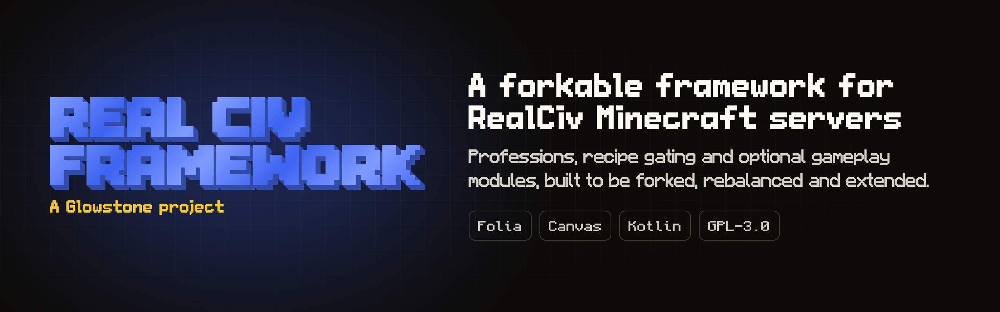

<p align="center"></p>

Real Civ Framework is an open-source framework for building **RealCiv** servers on Minecraft (Folia and Canvas), built to be forked, modified, and extended. It ships with a default set of professions you can keep, rebalance, or replace.

A RealCiv system makes civilisation part of the game itself. Professions, institutions, territory, trade, authority, and conflict are expressed through mechanics the server can understand and enforce—not just titles, chat channels, map labels, or rules that administrators must police by hand.

The goal is not to simulate real-world bureaucracy or impose a particular style of roleplay. It is to give players a coherent set of constraints and consequences from which societies can emerge naturally. Players decide how to organise, cooperate, compete, and govern; Real Civ Framework makes those choices meaningful inside the world.

This project is an independent implementation built from scratch for modern Minecraft servers. It treats the RealCiv idea as an open design space rather than a fixed specification: mechanics should fit Minecraft's gameplay loop, remain understandable to players, and create interesting decisions without replacing play with menus or administration.

## Principles

- **Mechanics over make-believe.** Important actions and decisions should have real in-game effects driving them.
- **Player-driven societies.** The system provides tools and consequences, not a prescribed political structure.
- **Minecraft first.** Features should grow out of gathering, building, exploration, trade, and conflict.
- **Legible rules.** Players and server owners should be able to understand why something happened.
- **Open development.** The implementation and its rules are available for communities to inspect, discuss, adapt, and improve.

## Using it as a framework

The kernel (`framework/`) handles profession XP, ranks, recipe gating, commands and the module lifecycle. Everything else is an optional module (`modules/`): the professions themselves, reinforcement, the downed state, survival pressure and so on. Each server picks its modules in `plugins/RealCivFramework/modules.yml`.

To change the game, start your own copy and edit or add modules. See [docs/modules.md](docs/modules.md) for what ships, and [docs/extending.md](docs/extending.md) for how to build your own.

Players use `/profession [id]` (also `/prof` or `/class`). Operators use `/professionxp list|add|set|clear` (also `/classxp`), which needs `rcf.professionxp`.

Several modules are inspired by the [Civlabs](https://civlabs.org) servers' mechanics. They are independent implementations; no Civlabs code is included.

<!-- template:start -->
## Starting your own server from this template

1. On GitHub, click **Use this template** and create your repository, then clone it.
2. Rebrand it, before your server has any player data:

   ```sh
   scripts/rename.sh MyCiv com.example.myciv
   ```

   This renames the plugin, the Kotlin package, the Gradle group, the permission prefix and the storage namespace (`myciv:` in player and chunk data). Don't change the namespace after launch: data saved under the old one stops being read.
3. Run `./gradlew build`. The plugin jar is in `folia/build/libs/`.
4. Pick your modules in `modules/Modules.kt` (what the build contains) and `plugins/<Name>/modules.yml` (what each server runs), then make the game yours.

Your copy is a derivative of Real Civ Framework, so it stays under [GPL-3.0](LICENSE): keep the licence, and share your source with anyone you give the plugin jar to. Running it on your own server doesn't count as giving it away.
<!-- template:end -->

## Building

Real Civ Framework requires JDK 25.

```sh
./gradlew build
```

## Contributing

Ideas, issues, and pull requests are welcome. See [CONTRIBUTING.md](CONTRIBUTING.md) for development guidance and [SECURITY.md](SECURITY.md) for private vulnerability reports.

Real Civ Framework is licensed under [GPL-3.0](LICENSE).
